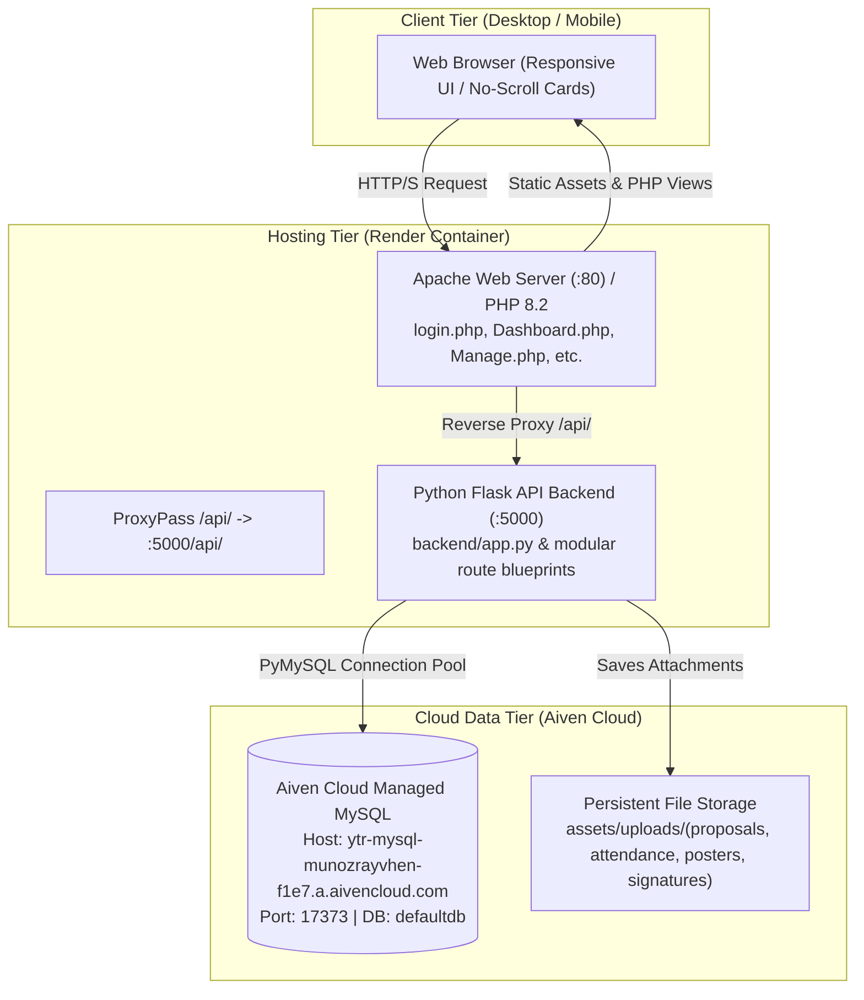

# Youth on the Rock (YTR) Community Platform
## Complete Project Summary & Chat Handover Documentation

> [!NOTE]
> This document serves as the comprehensive handover summary of all architectural changes, feature implementations, bug fixes, database schema states, and deployment configurations completed across the project. Use this reference when starting a new chat session.

---

## 1. System Architecture & Environment Overview



### Key Technical Details
- **Repository Location:** `C:\xampp\htdocs\Community-Centric-Event-Monitoring-and-Reporting-Platform - Copy`
- **Git Branches:**
  - `new_work`: Active development branch.
  - `main`: Production deployment branch synced directly with Render.
  - **Remote:** `https://github.com/nevy-18/Community-Centric-Event-Monitoring-and-Reporting-Platform.git`
- **Live Production URL:** `https://ytr-platform-y99r.onrender.com`
- **Database:** Aiven Cloud MySQL `ytr-mysql-munozrayvhen-f1e7.a.aivencloud.com:17373` (`defaultdb`).

---

## 2. Active Credentials & Account Matrix

| Account / Role | Email / Identifier | Password | Position / Privileges |
| :--- | :--- | :--- | :--- |
| **National Admin (CEO)** | `YTR.org@gmail.com`<br>*(or `admin@ytr.org` / username `Hanskee Joyce Jose`)* | `ytrnational`<br>*(or `Password123!`)* | **Chief Executive Operation (Hanskee Joyce Jose)**<br>Full admin, role overrides, RD assignments, CEO actions dropdown (system data flush/restore), chapter creation. |
| **National Admin (Host)** | `adminhost@gmail.com` | `Password123!` | **Regional Director (National) (Admin Host)**<br>National portal overview, account reviews, proposals, reports, requests. |
| **Chapter Admin** | `joan.dela@gmail.com`<br>*(or username `Joan Dela Cruz`)* | `Password123!` | **Chapter Coordinator (Joan Dela Cruz)**<br>Laguna Chapter dashboard, event proposals, reports, poster requests. |
| **Chapter Admin** | `munozrayvhen@gmail.com` | `Password123!` | **Chapter Coordinator (Rayvhen P Munoz)**<br>Laguna Chapter operations. |

---

## 3. Chronological Summary of Completed Works

### 1. Login Recovery, URL Sanitization & Admin Alias Support
- **Temporal Dead Zone Fix:** Fixed `ReferenceError: Cannot access 'chapterName' before initialization` in `assets/script.js`.
- **Form Submit Method & URL Scrubbing:** Upgraded login and registration forms in `login.php` with `method="POST" action="javascript:void(0);"` and URL scrubbers.
- **Dual Credentials & Alias:** In `backend/routes/auth_routes.py` and `api/auth.php`, configured alias resolution mapping `YTR.org@gmail.com` to `admin@ytr.org` and accepting both `ytrnational` and `Password123!`.

### 2. Tab Layout & "Add Partner Chapter" Alignment
- Re-architected tab navigation in `Manage.php` with a responsive flex container (`tab-nav-wrapper`) and full-width bottom baseline border (`border-bottom: 2px solid #e2e8f0`).
- Positioned the **Add Partner Chapter** button aligned right with a blue badge (`#0284c7`).

### 3. Removal of National Admin Audit Footprint & Dynamic Chapter Dropdowns
- **Audit Exclusion:** Suppressed audit log entries for National Admin actions across `Manage.php` and backend audit helpers.
- **Dynamic Partner Chapters:** Refactored chapter dropdowns in user registration (`login.php`) and account review modals (`Manage.php`) to query live chapters dynamically via `GET /api/chapters`.

### 4. Chapter Redundancy Elimination & Chapter Assignment Reassignment
- Removed duplicate chapter listings in review tables and user management cards.
- Restored the partner chapter assignment dropdown in the National Admin review modal.

### 5. Mobile Responsiveness & No-Scroll Card Architecture
- **Elimination of Table Scrolling:** Completely removed horizontal scrolling across mobile viewports (`@media (max-width: 768px)`).
- **Card-Based Mobile Transformation:** Data tables on mobile automatically transform into clean, stacked cards displaying labeled rows (`data-label`), status badges, and action buttons.

### 6. Modal Pop-up Previews (Replaced In-Page Previews)
- Converted embedded in-page previews for event proposals, poster request graphics, and accomplishment reports into dedicated pop-up modal dialogs.

### 7. Governance, Regional Director Assignments & CEO Role Restrictions
- Restricted chapter regional director assignments strictly to the **Chief Executive Operation** (`Hanskee Joyce Jose`).
- National Admins can override accounts to either National or Chapter scopes and delete accounts with confirmation guards.
- Protected sensitive administrative utilities (data flush and restore) inside an exclusive header dropdown visible only to the CEO.

### 8. Authentication Restriction Resolution & Confidential Error Catching
- **Eliminated Strict Format Restrictions on Login:**
  - Updated `login.php` input from `type="email"` to `type="text" autocomplete="username"` with label `Email address or Username` and placeholder `Enter your email or username`.
  - Removed client-side `validEmail()` block on login submission while retaining it for new account registration.
- **Universal Multi-Identifier Support (Email or Username):**
  - In `backend/routes/auth_routes.py` and `api/auth.php`, removed email format regex gating on login.
  - Queries match by `LOWER(u.email) = %s OR LOWER(u.full_name) = %s`, supporting full names as well as aliases.
- **Cloud Database Synchronization (Aiven MySQL):**
  - Updated primary root administrator account (User 1) to `YTR.org@gmail.com` with active status and password hash matching `ytrnational`.
  - Maintained active alias account for `admin@ytr.org` with master password support.
- **Confidential Error Messaging & Alert Container:**
  - Standardized invalid credential responses to `"Invalid email/username or password. Please verify your credentials and try again."`
  - Styled `.form-error` alert box in `assets/style.css` into a prominent alert container with accessible focus.

### 9. Action Redundancy Cleanup in Chapter Reports
- Removed the standalone **"Print Report"** button from the actions column in `ChapterReport.php` (`My Chapter Submitted Reports` table).
- The action column now cleanly displays the **"View Proposal"** button, which already embeds the official document dossier view and its built-in `"Print / Save as PDF"` functionality.

### 10. Dynamic Submitter Identity & Digital Signature Endorsement (Latest)
- **Account-Aware Submitter Binding:**
  - In `backend/routes/proposals_routes.py` and `api/proposals.php`, joined `event_reports` and submitter account tables so proposals reflect both the proposal requester and the actual report submitter / signer (`signed_by_name`, `report_submitter_name`, and `report_e_signature`).
  - New proposals created in `ChapterProposal.php` explicitly bind `created_by` to `currentUser.id`.
- **Dossier Modal Digital Signature & Identity Resolution:**
  - Across `ChapterReport.php`, `ChapterProposal.php`, and `Proposal.php`, the `"PREPARED & SUBMITTED BY"` section dynamically loads the account name of whoever actually filed and endorsed the event report (`r.signed_by_name || r.submitted_by_name || p.effective_submitter_name || currentUser.full_name`).
  - Added `#dossierSubmitterSigContainer` in modal templates: if a digital signature image or data URL was recorded upon submission, the actual signature graphic renders directly above the endorsement line in the printable dossier.
  - Submitter stamp clearly identifies `'Official Post-Event Report Filing'` when viewing filed events.
- **Universal Search Bar Text Visibility & Responsive Expansion:**
  - Resolved the text truncation issue where search bars were restricted to a narrow 150px input viewport by adding full flex expansion (`width: 100% !important; flex: 1 1 0% !important; min-width: 0 !important; font-size: 0.875rem; line-height: 1.5; padding: 0 !important;`) across `assets/National.css` and `assets/Chapter.css`.
  - Injected global `.search-bar` and `.search-bar input` rules into `includes/topbar.php` with high specificity (`!important`) to ensure instant cross-browser rendering bypassing external CSS caching.
  - Enhanced search bar containers and inputs across all 8 platform views (`Dashboard.php`, `ChapterDashboard.php`, `Proposal.php`, `Report.php`, `ChapterProposal.php`, `ChapterReport.php`, `ChapterRequest.php`, and `Request.php`) with responsive min-widths (`min-width: 320px; flex: 1; max-width: 480px;` in toolbar filters, and 100% in header cards) and focus rings (`box-shadow: 0 0 0 3px rgba(59, 130, 246, 0.15)`), guaranteeing that complete placeholders and long typed event names render fully without horizontal clipping.
- **Modern Neutral Signout Styling across Dashboards and Portals:**
  - Replaced the previous red/rose warning background (`rgba(244,63,94,0.2)`) on the square `.sign-out .icon` with a clean, subtle translucent background (`rgba(255, 255, 255, 0.1)`), delicate border (`1px solid rgba(255, 255, 255, 0.12)`), and smooth 8px rounded corners across `assets/National.css` and `assets/Chapter.css`.
  - Replaced the aggressive pink hover (`#fda4af`) with smooth, standard SaaS hover highlights (`rgba(255, 255, 255, 0.08)` row background, `rgba(255, 255, 255, 0.18)` icon background, and crisp `#ffffff` text).
  - Added inline style overrides to `includes/sidebar.php` and `includes/sidebar_chapter.php` for bulletproof cross-browser rendering: `<div class="icon" style="background: rgba(255, 255, 255, 0.1); border: 1px solid rgba(255, 255, 255, 0.12); color: #ffffff;"><i class="ph ph-sign-out" style="color: #ffffff;"></i></div>`.
  - Removed `text-rose` from topbar user profile dropdown Sign Out items in `includes/topbar.php` for a unified, professional user experience matching modern enterprise systems.
- **Interactive Post-Event Report Reminder Modal in National Dashboard (`Dashboard.php`):**
  - Upgraded the static "Remind / View" button in the Conducted Events table to an interactive modal trigger `<button onclick="openRemindModal(...)"><i class="ph-bold ph-bell"></i> Remind Chapter</button>`.
  - Added `#remindChapterModal` dialog featuring target chapter & event overview, deadline status badges, customizable reminder subject, and an editable message textarea.
  - Implemented client API method `YTR_API.chapters.sendReminder(chapterId, payload)` in `assets/api-client.js`.
  - Added backend route `POST /api/chapters/<chapter_id>/remind` in `backend/routes/chapters_routes.py`:
    - Dispatches targeted notifications to all active Chapter Admins and Coordinators for the target chapter.
    - Inserts records into the `notifications` table (`related_type='event_report'`, `target_url='ChapterReport.php'`).
    - Records an audit log entry in `audit_logs` capturing sender identity and target event details.
- **Role-Tailored Notification System (`backend/routes/notifications_routes.py`):**
  - Enhanced `GET /api/notifications/summary` to query and surface direct user notifications from the `notifications` table for the authenticated user (`X-User-Id` / `X-User-Email`).
  - Chapter Admins receive reminders directly in their interactive topbar notification bell, opening the post-event reporting interface.
  - Added `PUT /api/notifications/<id>/read` and `PUT /api/notifications/read-all` endpoints.
- **Removal of Redundant "Chapter Submission View" Button (`Report.php`):**
  - Cleaned up the header actions in `Report.php` by removing the redundant `<a href="ChapterReport.php">Go to Chapter Submission View</a>` link, preserving the "Upload Executive Signature" button.
- **Dashboard Table Simplification & Pop-up Details Modals (`Dashboard.php` & `ChapterDashboard.php`):**
  - **Removed Visual Clutter & Redundant Tags:** Stripped out region code tags (e.g., `YTR-LAG`), region subtitles, program pillar badges, and venue clutter from default table rows across both National and Chapter dashboards.
  - **Streamlined Column Architecture:** Condensed table columns to 5 clean, intuitive columns (National: *Chapter, Conducted Event, Status, Deadline, Action*; Chapter: *Event Title, Schedule, Status, Turnout, Action*).
  - **Pop-up Event Details Modals:**
    - `Dashboard.php` (`#eventDetailsModal`): Displays comprehensive host chapter specifications (code, region), event schedule & logistics (pillar, venue, date), post-event reporting compliance, and direct quick-action buttons (Send Reminder / View Report).
    - `ChapterDashboard.php` (`#chapterEventDetailsModal`): Displays full program classifications, start/end datetimes, venue, demographic targeting, visual turnout progress bar with breakdown, and endorsement/signature status.
  - **Responsive Single-Line Layout & Distortion Prevention:**
    - Applied `white-space: nowrap !important;` across table headers and cells to prevent awkward multi-line text wrapping when screen shrinks.
    - Integrated `.dash-text-truncate` with graceful ellipsis (`text-overflow: ellipsis`) and hover tooltips for long titles.
    - Enforced responsive 1-column grid collapse (`.chapter-dash-grid` at `@media (max-width: 1100px)`) so monitoring tables never cramp against announcements.
    - Configured smooth horizontal touch-scrolling (`overflow-x: auto !important; -webkit-overflow-scrolling: touch !important;`) on table containers.
  - **Removed Side Announcements from Chapter Overview (`ChapterDashboard.php`):**
    - Removed the cramped 2-column sidebar grid layout completely from Chapter Overview (`ChapterDashboard.php`), expanding the Activity & Pending Monitoring table to 100% full width.
    - Eliminated any risk of side widgets squishing or pushing table columns, matching the clean full-width layout of the National Dashboard.
    - Announcements remain fully accessible via the dedicated "Announcements" sidebar page (`Announcement.php`) and topbar interactive notification bell.
- **Event Proposal Simplification & Pop-up Dossier Modals (`Proposal.php` & `ChapterProposal.php`):**
  - **National Proposals Table (`Proposal.php`):**
    - Condensed rows to 6 clean single-line columns: *Event Proposal, Chapter, Schedule, Budget, Status, Action*.
    - Stripped out up to 7 stacked badges per row (program pillar, audience, soft copy, drive link, timer badges).
    - Added clean "Details" button calling `openProposalDossier(id)` to open the complete official dossier pop-up modal alongside the "Review / View" button.
  - **Chapter Proposals Table (`ChapterProposal.php`):**
    - Condensed rows to 5 clean single-line columns: *Event Title, Schedule, Budget, Status, Action*.
    - Removed nested badge clutter and venue wrapping from the default rows.
    - Integrated "Details" button opening the full electronic proposal dossier pop-up modal with print/soft-copy export.
  - **Responsive Single-Line Layout:**
    - Applied `white-space: nowrap !important;` across all table headers and cells.
    - Integrated `.dash-text-truncate` with ellipsis and full tooltip on hover.

---

## 4. Key File Layout & Directory Structure

```
Community-Centric-Event-Monitoring-and-Reporting-Platform - Copy/
├── api/                           # Fallback PHP API endpoints
│   ├── auth.php                   # Authentication endpoint (email/username login)
│   ├── proposals.php              # Proposals with report signer join
│   ├── db.php                     # PDO connection
│   └── response.php               # JSON formatting helpers
├── assets/                        # Frontend UI assets
│   ├── api-client.js              # Centralized JavaScript client for Flask backend
│   ├── script.js                  # Login/signup/auth DOM controller with error catch
│   ├── style.css                  # Unified styling with alert boxes & responsive cards
│   └── uploads/                   # Upload storage (proposals, attendance, posters, signatures)
├── backend/                       # Python Flask API backend
│   ├── app.py                     # Main Flask application initialization
│   ├── db.py                      # PyMySQL database connection manager
│   ├── auth_helpers.py            # Bcrypt hashing, session & token validation
│   └── routes/                    # Modular API route blueprints
│       ├── auth_routes.py         # Login, register, forgot-password, me
│       ├── account_routes.py      # Account approvals, overrides, deletion
│       ├── chapter_routes.py      # Partner chapters, RD assignment
│       ├── proposals_routes.py    # Event proposal submission, approval, PDFs & report joins
│       ├── reports_routes.py      # Accomplishment report lifecycle
│       ├── poster_requests_routes.py # Creative poster request queue & review
│       └── system_routes.py       # Data archive, non-destructive flush & restore
├── apache-render.conf             # VirtualHost configuration with /api/ reverse proxy
├── Dockerfile                     # Combined PHP 8.2 + Python 3 container definition
├── login.php                      # Main authentication portal (Email or Username)
├── Manage.php                     # National Account & Partner Chapter management
├── Dashboard.php                  # National Administration overview
├── ChapterDashboard.php           # Chapter Administration workspace
├── ChapterReport.php              # Chapter branch event reporting & evaluation
├── ChapterProposal.php            # Chapter event proposal creation & dossier
├── Proposal.php                   # National event proposal review & dossier
└── start.sh                       # Container startup script (Flask + Apache)
```
