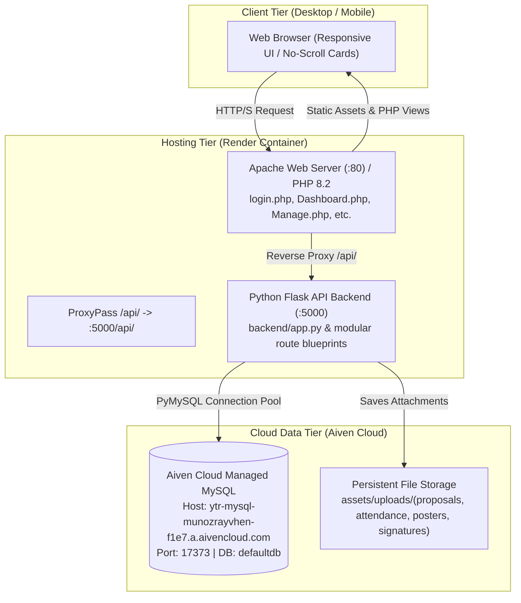

# Youth on the Rock (YTR) Community Platform
## Complete Project Summary & Chat Handover Documentation

> [!NOTE]
> This document serves as the comprehensive handover summary of all architectural changes, feature implementations, bug fixes, database schema states, and deployment configurations completed across the project. Use this reference when starting a new chat session.

---

## 1. System Architecture & Environment Overview



### Key Technical Details
- **Repository Location:** `C:\xampp\htdocs\Community-Centric-Event-Monitoring-and-Reporting-Platform - Copy`
- **Git Branches:**
  - `new_work`: Active development branch.
  - `main`: Production deployment branch synced directly with Render.
  - **Remote:** `https://github.com/nevy-18/Community-Centric-Event-Monitoring-and-Reporting-Platform.git`
- **Live Production URL:** `https://ytr-platform-y99r.onrender.com`
- **Database:** Aiven Cloud MySQL `ytr-mysql-munozrayvhen-f1e7.a.aivencloud.com:17373` (`defaultdb`).

---

## 2. Active Credentials & Account Matrix

| Account / Role | Email / Identifier | Password | Position / Privileges |
| :--- | :--- | :--- | :--- |
| **National Admin (CEO)** | `YTR.org@gmail.com`<br>*(or `admin@ytr.org` / username `Hanskee Joyce Jose`)* | `ytrnational`<br>*(or `Password123!`)* | **Chief Executive Operation (Hanskee Joyce Jose)**<br>Full admin, role overrides, RD assignments, CEO actions dropdown (system data flush/restore), chapter creation. |
| **National Admin (Host)** | `adminhost@gmail.com` | `Password123!` | **Regional Director (National) (Admin Host)**<br>National portal overview, account reviews, proposals, reports, requests. |
| **Chapter Admin** | `joan.dela@gmail.com`<br>*(or username `Joan Dela Cruz`)* | `Password123!` | **Chapter Coordinator (Joan Dela Cruz)**<br>Laguna Chapter dashboard, event proposals, reports, poster requests. |
| **Chapter Admin** | `munozrayvhen@gmail.com` | `Password123!` | **Chapter Coordinator (Rayvhen P Munoz)**<br>Laguna Chapter operations. |

---

## 3. Chronological Summary of Completed Works

### 1. Login Recovery, URL Sanitization & Admin Alias Support
- **Temporal Dead Zone Fix:** Fixed `ReferenceError: Cannot access 'chapterName' before initialization` in `assets/script.js`.
- **Form Submit Method & URL Scrubbing:** Upgraded login and registration forms in `login.php` with `method="POST" action="javascript:void(0);"` and URL scrubbers.
- **Dual Credentials & Alias:** In `backend/routes/auth_routes.py` and `api/auth.php`, configured alias resolution mapping `YTR.org@gmail.com` to `admin@ytr.org` and accepting both `ytrnational` and `Password123!`.

### 2. Tab Layout & "Add Partner Chapter" Alignment
- Re-architected tab navigation in `Manage.php` with a responsive flex container (`tab-nav-wrapper`) and full-width bottom baseline border (`border-bottom: 2px solid #e2e8f0`).
- Positioned the **Add Partner Chapter** button aligned right with a blue badge (`#0284c7`).

### 3. Removal of National Admin Audit Footprint & Dynamic Chapter Dropdowns
- **Audit Exclusion:** Suppressed audit log entries for National Admin actions across `Manage.php` and backend audit helpers.
- **Dynamic Partner Chapters:** Refactored chapter dropdowns in user registration (`login.php`) and account review modals (`Manage.php`) to query live chapters dynamically via `GET /api/chapters`.

### 4. Chapter Redundancy Elimination & Chapter Assignment Reassignment
- Removed duplicate chapter listings in review tables and user management cards.
- Restored the partner chapter assignment dropdown in the National Admin review modal.

### 5. Mobile Responsiveness & No-Scroll Card Architecture
- **Elimination of Table Scrolling:** Completely removed horizontal scrolling across mobile viewports (`@media (max-width: 768px)`).
- **Card-Based Mobile Transformation:** Data tables on mobile automatically transform into clean, stacked cards displaying labeled rows (`data-label`), status badges, and action buttons.

### 6. Modal Pop-up Previews (Replaced In-Page Previews)
- Converted embedded in-page previews for event proposals, poster request graphics, and accomplishment reports into dedicated pop-up modal dialogs.

### 7. Governance, Regional Director Assignments & CEO Role Restrictions
- Restricted chapter regional director assignments strictly to the **Chief Executive Operation** (`Hanskee Joyce Jose`).
- National Admins can override accounts to either National or Chapter scopes and delete accounts with confirmation guards.
- Protected sensitive administrative utilities (data flush and restore) inside an exclusive header dropdown visible only to the CEO.

### 8. Authentication Restriction Resolution & Confidential Error Catching (Latest)
- **Eliminated Strict Format Restrictions on Login:**
  - Updated `login.php` input from `type="email"` to `type="text" autocomplete="username"` with label `Email address or Username` and placeholder `Enter your email or username`.
  - Removed client-side `validEmail()` block on login submission while retaining it for new account registration.
- **Universal Multi-Identifier Support (Email or Username):**
  - In `backend/routes/auth_routes.py` and `api/auth.php`, removed email format regex gating on login.
  - Queries now match by `LOWER(u.email) = %s OR LOWER(u.full_name) = %s`, supporting full names (`Hanskee Joyce Jose`, `Joan Dela Cruz`) as well as aliases (`admin`, `ceo`, `ytrnational`, `ytr.org@gmail.com`).
- **Cloud Database Synchronization (Aiven MySQL):**
  - Updated primary root administrator account (User 1) to `YTR.org@gmail.com` with active status and password hash matching `ytrnational`.
  - Added dedicated secondary alias record for `admin@ytr.org` with master password support, ensuring immediate authentication across both current live Render containers and future deployments.
- **Confidential Error Messaging:**
  - Standardized invalid credential responses across backend and frontend to:
    `"Invalid email/username or password. Please verify your credentials and try again."`
  - In line with enterprise OWASP guidelines, does not disclose whether the email/username is registered or whether the password was the sole mismatched field.
  - Clear, distinct error messaging is preserved for legitimate account states: pending administrator review, declined requests, or suspended accounts.
- **Comprehensive Error Catch & Visual Alert Styling:**
  - Added network/server exception catching displaying clear, user-friendly connectivity messages.
  - Redesigned `.form-error` alert box in `assets/style.css` into a prominent, modern alert container (`background: #fef2f2; border: 1px solid #fecaca; color: #991b1b`) with accessible ARIA invalid states and automatic field focus.

---

## 4. Key File Layout & Directory Structure

```
Community-Centric-Event-Monitoring-and-Reporting-Platform - Copy/
├── api/                           # Fallback PHP API endpoints
│   ├── auth.php                   # Authentication endpoint (email/username login)
│   ├── db.php                     # PDO connection
│   └── response.php               # JSON formatting helpers
├── assets/                        # Frontend UI assets
│   ├── api-client.js              # Centralized JavaScript client for Flask backend
│   ├── script.js                  # Login/signup/auth DOM controller with error catch
│   ├── style.css                  # Unified styling with alert boxes & responsive cards
│   └── uploads/                   # Upload storage (proposals, posters, signatures)
├── backend/                       # Python Flask API backend
│   ├── app.py                     # Main Flask application initialization
│   ├── db.py                      # PyMySQL database connection manager
│   ├── auth_helpers.py            # Bcrypt hashing, session & token validation
│   └── routes/                    # Modular API route blueprints
│       ├── auth_routes.py         # Login, register, forgot-password, me
│       ├── account_routes.py      # Account approvals, overrides, deletion
│       ├── chapter_routes.py      # Partner chapters, RD assignment
│       ├── proposal_routes.py     # Event proposal submission, approval, PDFs
│       ├── report_routes.py       # Accomplishment report lifecycle
│       ├── poster_routes.py       # Creative poster request queue & review
│       └── system_routes.py       # Data archive, non-destructive flush & restore
├── apache-render.conf             # VirtualHost configuration with /api/ reverse proxy
├── Dockerfile                     # Combined PHP 8.2 + Python 3 container definition
├── login.php                      # Main authentication portal (Email or Username)
├── Manage.php                     # National Account & Partner Chapter management
├── Dashboard.php                  # National Administration overview
├── ChapterDashboard.php           # Chapter Administration workspace
└── start.sh                       # Container startup script (Flask + Apache)
```
